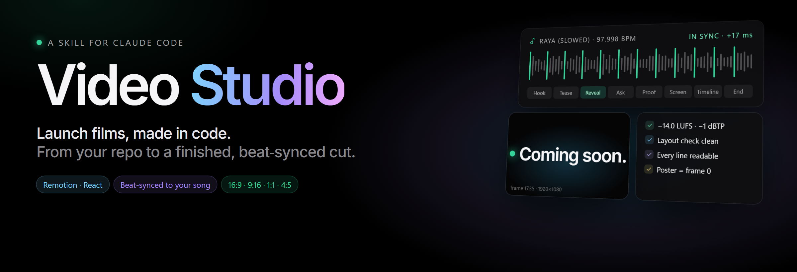
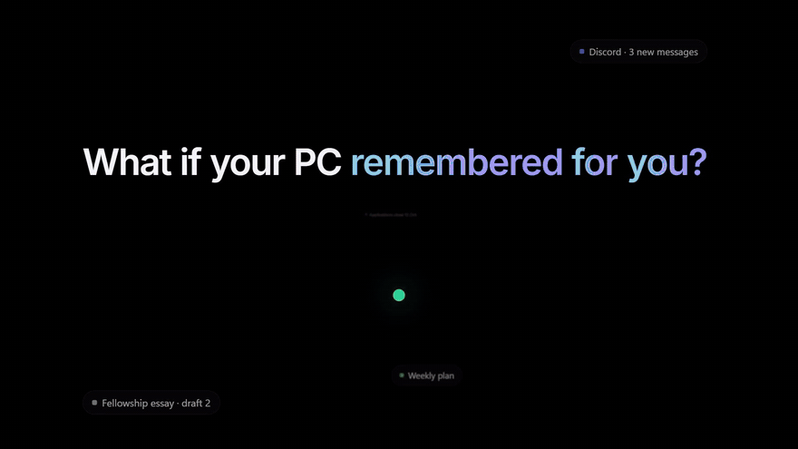
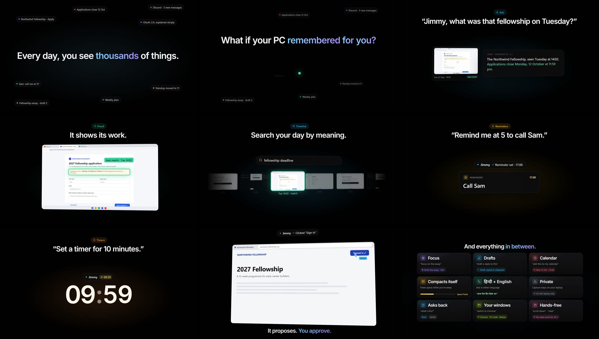
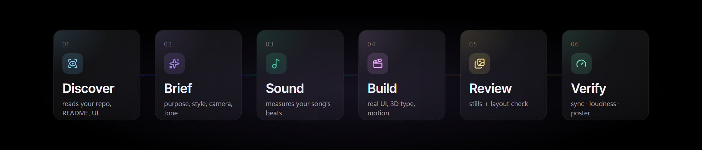

<p align="center">
  
</p>

<p align="center">
  <b>Point Claude at your project. Get a launch film back.</b><br>
  Video Studio reads your repo, asks what you want, cuts to your song's real beats,<br>
  and checks its own work before you ever press play.
</p>

<p align="center">
  
  
  
  
  
</p>

<p align="center">
  <a href="#-watch">Watch</a> ·
  <a href="#-just-ask">Just ask</a> ·
  <a href="#-how-it-works">How it works</a> ·
  <a href="#-the-quality-bar">Quality bar</a> ·
  <a href="#-install">Install</a> ·
  <a href="#-whats-inside">What's inside</a>
</p>

---

## 🎬 Watch

<p align="center">
  
</p>

<p align="center"><sub>
  A 60-second launch trailer for <b>Jimmy</b>, a Windows assistant, made with this skill in one session from its codebase.<br>
  Silent preview here; the real cut is synced to a song. Every UI is rebuilt from the product's code with invented demo data.
</sub></p>

<details>
<summary><b>See every scene</b></summary>
<br>
<p align="center"></p>
</details>

---

## 💬 Just ask

No templates to fill in. Talk to Claude Code from inside any project:

<table>
<tr>
  <td width="50%" valign="top">
    <code>make a launch video for this app</code><br>
    <sub>Reads the README and UI, picks the flow worth showing, proposes a story.</sub>
  </td>
  <td width="50%" valign="top">
    <code>cut it to my song, raya.mp3</code><br>
    <sub>Measures the real tempo and drops; lands the reveal on the hit.</sub>
  </td>
</tr>
<tr>
  <td valign="top">
    <code>a 15-second Reel about the new search</code><br>
    <sub>9:16 with platform safe areas, a hook in the first 2 seconds.</sub>
  </td>
  <td valign="top">
    <code>more adrenaline, one skill per shot</code><br>
    <sub>Re-cuts only the named scenes, re-checks, re-renders as v2.</sub>
  </td>
</tr>
<tr>
  <td valign="top">
    <code>/brag</code><br>
    <sub>Quick mode: it decides style, tone and sound and tells you what it chose.</sub>
  </td>
  <td valign="top">
    <code>end on "Coming soon" instead</code><br>
    <sub>Small notes, small diffs. Earlier versions are never overwritten.</sub>
  </td>
</tr>
</table>

---

## ⚙️ How it works

<p align="center"></p>

<table>
  <tr>
    <td width="33%" valign="top">
      <h3>🔎 It studies first</h3>
      Your README, your real UI labels, your flow. The film is about the actual product:
      real features, true numbers, no generic SaaS filler.
    </td>
    <td width="33%" valign="top">
      <h3>🎵 It hears the song</h3>
      Kicks, tempo and drops are <b>measured</b>, even syncopated 3‑3‑2 phonk. Your song
      plays uncut, or gets a smooth 1–2 join edit when you ask.
    </td>
    <td width="33%" valign="top">
      <h3>🎥 It moves like a camera</h3>
      The camera always glides. The beat drives the <i>elements</i> and the
      <i>transitions</i>, never a shaky lens.
    </td>
  </tr>
  <tr>
    <td valign="top">
      <h3>🧩 It builds in React</h3>
      Remotion scenes with a theme-driven kit: CSS-3D UI, kinetic type, counting
      numbers, light, and four aspect ratios from one storyboard.
    </td>
    <td valign="top">
      <h3>🖼️ It looks before it renders</h3>
      Contact sheets of stills cost seconds; renders cost minutes. Every scene is
      checked on a still first.
    </td>
    <td valign="top">
      <h3>✅ It verifies the file</h3>
      Sync is measured on the rendered MP4, the mix is mastered, and the poster becomes
      frame 0 so chat apps show the right thumbnail.
    </td>
  </tr>
</table>

---

## 📏 The quality bar

Every render is checked against numbers, not vibes:

| Check | Target | How |
|---|---|---|
| **Music sync** | within ±20 ms, no drift | `verify_sync.py` cross-correlates the rendered audio with the master |
| **Loudness** | −14 LUFS, ≤ −1 dBTP | two-pass `loudnorm`; `finish.py` re-normalises if effects push it off |
| **Readability** | ≥ 0.3 s per word, once settled | `[readability]` warnings in the render log |
| **Layout** | nothing off the frame, no orphaned last word | `[layout]` warnings from the kit, shown on every contact sheet |
| **Song edits** | joins ≥ 0.93 similarity, on bar lines | `edit_song.py --join` scores each join before it is used |
| **Honesty** | real features, invented demo data | built into the workflow, never the user's real data |

---

## 📦 Install

**Claude Code** (any OS): put the `video-studio` folder in your skills directory.

```bash
git clone https://github.com/Adhrit-Verma/video-studio.git
cp -r video-studio/video-studio ~/.claude/skills/video-studio
```

On Windows (PowerShell), link it so `git pull` updates the skill:

```powershell
New-Item -ItemType Junction -Path "$env:USERPROFILE\.claude\skills\video-studio" -Target "$PWD\video-studio\video-studio"
```

**claude.ai / Claude desktop:** download [`dist/video-studio.skill`](dist/video-studio.skill) and add it under
**Settings → Capabilities → Skills**.

**The machine that renders needs:** Node 18+, ffmpeg on `PATH`, Python 3 with `numpy` and `Pillow`.
Blender only for the optional photoreal product shots.

> **Laptop-friendly by design.** Iterate with stills and half-scale drafts; render full-res once,
> at Remotion's default concurrency.

---

## 🗂️ What's inside

```
video-studio/                 the skill
├── SKILL.md                  the workflow Claude follows (discover → brief → … → deliver)
├── references/               styles, camera, tones, moods, editing footage, personal films, trends,
│                             techniques, sound, formats, honesty
├── scripts/
│   ├── discover.py           read a repo or site into a product brief
│   ├── analyze_music.py      measure tempo + phase from the kicks (any pattern)
│   ├── edit_song.py          map a song, score joins, build a smooth edit
│   ├── gen_beat.py           an original beat when there's no song
│   ├── master_audio.py       master, energy/bass envelopes, strongest cues
│   ├── contact_sheet.py      stills → a labelled sheet + layout warnings
│   ├── clip_moments.py       shortlist usable moments in clips/photos, flag duplicates, contact sheets
│   ├── speed_ramp.py         velocity edits and smooth slow motion as new clips
│   ├── verify_sync.py        measure sync on the rendered file
│   └── finish.py             final loudness, poster, poster as frame 0
└── assets/
    ├── template/             the Remotion starter: kit.jsx, theme.js, 4 formats
    └── sfx/                  CC0 sound effects, analysed for safe reuse
dist/video-studio.skill       the packaged skill
examples/jimmy-trailer/       the film above, as source
docs/                         README art (rendered with the skill's own kit)
```

---

## 🙏 Credits

- Tones, creative laws (hook, reading-time floors, "show the product in use"), the planning rubric,
  strong-cue scoring, the SFX selection method, poster-as-frame-0 and share copy are adapted from
  [latent-spaces/brag](https://github.com/latent-spaces/brag) (MIT, © Shunit Haviv Hakimi),
  re-implemented for this Remotion workflow.
- Sound effects: [Kenney](https://kenney.nl/) (CC0) and Keyboard Soundpack #1 by unicae_games (CC0).
- Built with [Remotion](https://www.remotion.dev/). Rendering videos commercially may need a
  [Remotion company license](https://www.remotion.dev/license).

<p align="center"><sub>MIT licensed · made with Claude Code</sub></p>
